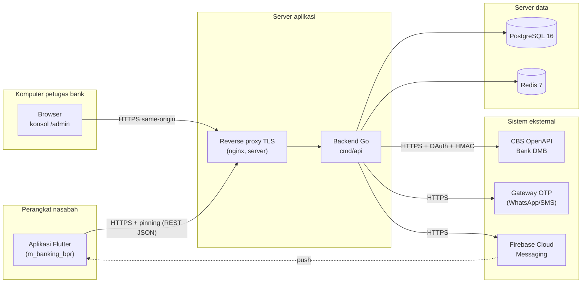
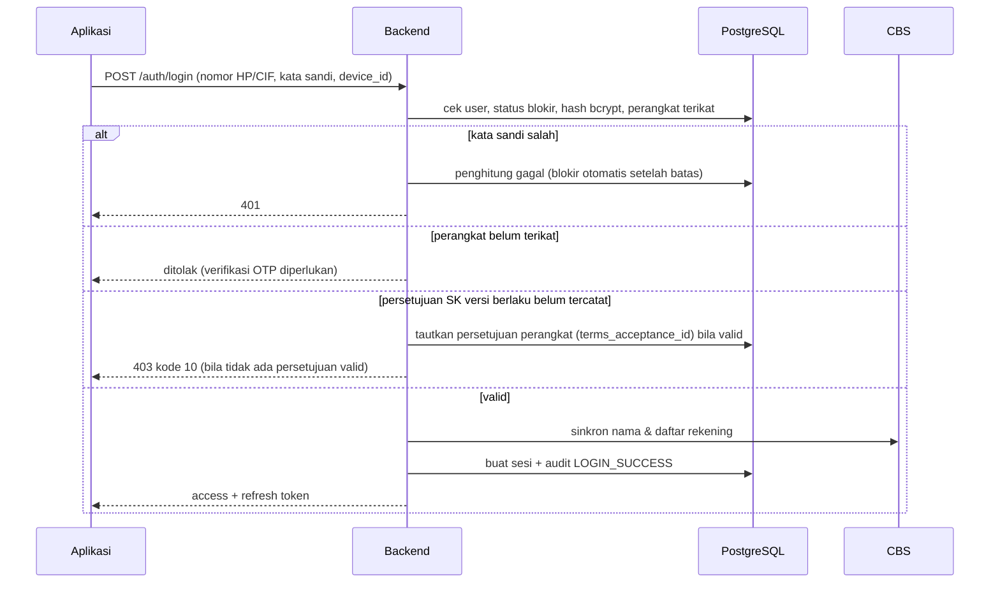
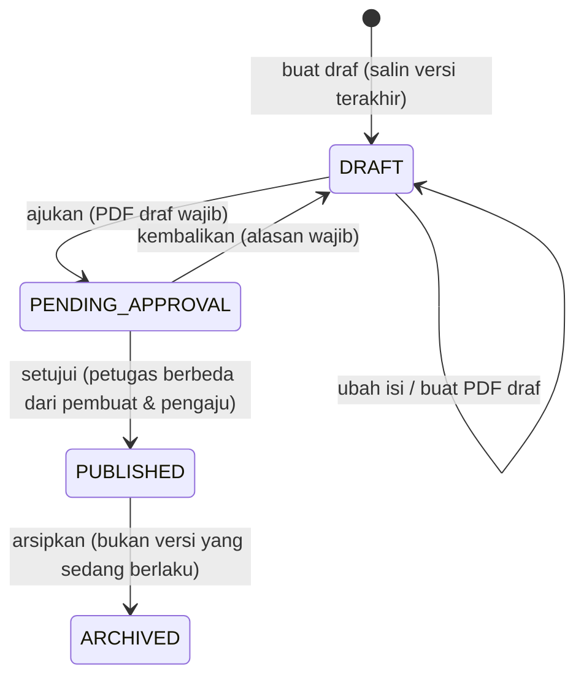
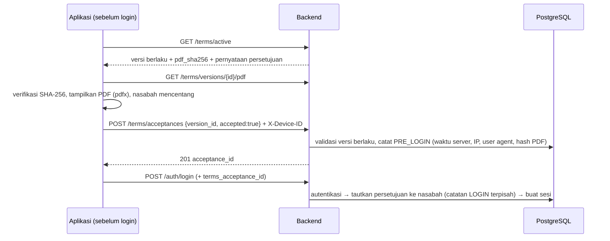

# Arsitektur Sistem MBanking BPR

| Atribut | Nilai |
|---|---|
| Diperbarui | 14 November 2026 |
| Status | Menggambarkan kode di repository saat ini. Belum ada environment server; integrasi CBS live, gateway OTP, dan FCM **belum diverifikasi** end-to-end |
| Sumber kebenaran | `cmd/api/main.go`, `internal/app/router.go`, `internal/`, `pkg/`, `m_banking_bpr/lib/` |

## 1. Komponen dan lokasi berjalan



| Komponen | Berjalan di | Tanggung jawab | Status |
|---|---|---|---|
| Aplikasi Flutter | HP nasabah (Android; iOS belum disiapkan untuk rilis) | Antarmuka nasabah; tidak menyimpan secret backend | IMPLEMENTED |
| Konsol admin (`web/admin`) | Browser petugas; file statis disajikan backend di `/admin` | Operasional petugas (RBAC) | IMPLEMENTED |
| Backend Go (`cmd/api`) | Server aplikasi | REST API, autentikasi, otorisasi, audit | IMPLEMENTED |
| PostgreSQL | Server data | Identitas aplikasi, sesi, audit, notifikasi, pengajuan | IMPLEMENTED |
| Redis | Server data | OTP dan rate limit lintas instance (memori di local) | IMPLEMENTED |
| CBS OpenAPI | Vendor/bank | Sumber resmi nasabah, rekening, saldo, mutasi | Kode IMPLEMENTED; uji live NOT VERIFIED |
| Gateway OTP | Pihak ketiga | Pengiriman OTP (Fonnte, Wablas, atau webhook) | Kode IMPLEMENTED; vendor resmi belum ditetapkan |
| FCM | Google | Push notification | **PARTIAL** — backend memakai endpoint FCM *legacy* (`fcm.googleapis.com/fcm/send`) yang perlu dimigrasi ke HTTP v1 |
| Reverse proxy | Server aplikasi | TLS termination | Contoh konfigurasi saja (`deploy/nginx/mbanking.conf.example`) |

Data rekening, saldo, mutasi, pinjaman, deposito, dan katalog produk **bersumber dari CBS**.
Database aplikasi tidak menjadi sumber saldo. Bila CBS gangguan, backend menjawab 503 dengan pesan
"… belum dapat ditampilkan" — tidak ada fallback ke data lokal, cache, atau dummy.

Pengujian local memakai `ENABLE_MOCK_CBS=true`: ledger PostgreSQL local (`DatabaseCBSProvider`)
yang kosong dan diisi nasabah uji melalui `cmd/localfixture`. Mode ini ditolak di staging/production.
Mode `STANDALONE_CORE` (aplikasi sebagai core banking) ditolak di semua environment.

## 2. Pemisahan frontend dan backend

* Aplikasi Flutter hanya berkomunikasi dengan backend melalui REST API `/api/v1/*`; tidak pernah
  langsung ke CBS, database, gateway OTP, atau secret apa pun.
* Alamat backend ditentukan saat build (`APP_FLAVOR`, `API_BASE_URL`, `API_CERT_PINS`); tidak ada
  alamat bawaan atau fallback server.
* Backend menjadi satu-satunya pemegang kredensial CBS, kunci JWT, kunci enkripsi, dan kredensial
  database.

## 3. Struktur repository

```
cmd/            api (server) · migrate · localfixture · auditverify · rekey
config/         loader konfigurasi terpusat
internal/
  app/          wiring router, middleware, /health, /ready
  module/       auth · account · transaction · customer · admin (handler → service → repository)
  cbsprovider/  OpenAPICBSProvider (live) · DatabaseCBSProvider (ledger local)
  ownership/    otorisasi kepemilikan rekening (anti IDOR/BOLA)
  otp/ notification/ audit/ session/ rekey/ domain/ model/
pkg/            database (+migrations) · money · security · crypto · middleware · logger · redis · response · reqctx
test/integration/  integration test PostgreSQL
web/admin/      konsol petugas (HTML/JS statis)
m_banking_bpr/  aplikasi Flutter: lib/core · lib/data · lib/presentation · config/*.json · test/
api/cbs/        spesifikasi OpenAPI & koleksi Postman CBS (kontrak upstream)
deploy/         nginx · systemd · sql (role) · docker (init role) · scripts (backup/restore)
scripts/local/  skrip PowerShell local
```

## 4. Backend

Urutan startup (`cmd/api/main.go`), semuanya fail-fast: konfigurasi → kunci enkripsi → koneksi
PostgreSQL → verifikasi skema (`EnsureSchemaCurrent`, backend tidak menjalankan DDL) → bootstrap
admin (opsional) → Redis → provider CBS → router → HTTP server dengan graceful shutdown (SIGTERM).

| Lapisan | Lokasi | Tanggung jawab |
|---|---|---|
| Middleware | `pkg/middleware` | security header, CORS allowlist, request log ber-`request_id`, autentikasi nasabah/petugas, RBAC, rate limit |
| Handler | `internal/module/*/delivery/http` | parsing request, pemetaan error ke HTTP |
| Service | `internal/module/*/service` | aturan bisnis, audit, notifikasi |
| Repository | `internal/module/*/repository` | query GORM yang dibatasi `user_id` dari token |
| CBS | `internal/cbsprovider` | OAuth, signature HMAC-SHA512, pemetaan nominal ke `money.Amount` |

### REST API (prefix `/api/v1`, daftar otoritatif `internal/app/router.go`)

| Kelompok | Endpoint | Akses |
|---|---|---|
| Publik | `GET /banners`, `GET /config` (konten terbit + `content_version`) | rate limit per IP |
| Syarat & Ketentuan (publik) | `GET /terms/active`, `GET /terms/versions/:id/pdf` (hanya PUBLISHED/ARCHIVED), `POST /terms/acceptances` (header `X-Device-ID`) | rate limit per IP |
| Autentikasi | `POST /auth/login`, `/auth/refresh`, `/auth/activate/{verify,otp,setup}`, `/auth/forgot-password/{request,otp,reset}` | rate limit per IP dan identitas |
| Nasabah | `POST /auth/logout`, `/auth/change-password`, `/auth/change-pin` | token nasabah + sesi + perangkat |
| Rekening | `GET /account/{balance,mutations,profile,list,loans,deposits,products}` dan detail pinjaman/deposito | token nasabah |
| Lainnya | `applications`, `notifications` (+ `/read`, `/fcm-token`), `GET /terms/status` | token nasabah |
| Petugas | `/admin/*` (login, statistik, nasabah, banner, audit log, broadcast, pengajuan, konfigurasi operasional, upload gambar, user, CBS health, `/admin/terms/*`, `/admin/content*`) | token petugas + RBAC (SUPER_ADMIN, CS, MARKETING, COMPLIANCE) |
| Operasional | `GET /health` (liveness), `GET /ready` (database & Redis) | publik, tanpa detail |

### Penanganan error

| Kelas | HTTP | Pesan ke klien |
|---|---|---|
| Konfigurasi tidak valid | — | proses berhenti saat startup |
| Persetujuan SK versi berlaku belum tercatat | 403, kode `10` | "Anda perlu membaca dan menyetujui Syarat dan Ketentuan…" |
| Belum ada SK yang berlaku | 503, kode `11` | "Syarat dan Ketentuan layanan belum tersedia…" |
| Menyetujui versi yang tidak berlaku | 409, kode `12` | minta muat ulang dokumen |
| Validasi input | 400 | pesan aman |
| Autentikasi gagal / sesi tidak berlaku | 401 | — |
| Rekening bukan milik nasabah | 403 | — |
| Data tidak ditemukan | 404 | — |
| Gangguan CBS/database / error internal | 503 | pesan generik; detail hanya di log server (data sensitif dimasking) |

## 5. Autentikasi, otorisasi, dan sesi

* **Token**: JWT HS256; nasabah dan petugas memakai kunci, audience, dan tipe token berbeda
  (`pkg/security`, `pkg/middleware/auth.go`). Access token nasabah default 15 menit, refresh 7 hari,
  token petugas 60 menit.
* **Sesi server-side** (`internal/session`): token membawa `sid` yang diperiksa setiap request;
  logout mencabut sesi; refresh token dirotasi dengan deteksi pemakaian ulang.
* **Device binding**: header `X-Device-ID` wajib cocok dengan token. Login dari perangkat yang belum
  terikat ditolak; perangkat diikat melalui alur ber-OTP (aktivasi atau lupa kata sandi) atau
  setelah petugas CS melakukan reset perangkat.
* **Otorisasi nasabah**: CIF dan user id selalu diambil dari token; nomor rekening dari klien
  divalidasi `internal/ownership` terhadap CBS (fail-closed; gangguan CBS = 503, bukan 403).
* **Otorisasi petugas**: RBAC per route (`RequireRoles`).

## 6. Alur utama

### Login



### Saldo dan mutasi

1. Aplikasi memanggil `GET /account/balance` atau `GET /account/mutations` (rentang maks. 31 hari)
   dengan token.
2. Backend memvalidasi token, sesi, dan perangkat; memastikan rekening milik CIF token (`ownership`).
3. Backend memanggil CBS (`/api/savings-account-balance`, `/api/savings-account-mutations`).
   Mutasi mencakup transaksi dari kanal lain bank (termasuk transfer historis) sebagai riwayat saja.
4. CBS gagal/timeout → 503; aplikasi menampilkan "… belum dapat ditampilkan" dan tidak menampilkan
   saldo Rp 0.

DMB Mobile **tidak** menyediakan fitur transfer dana (tidak ada endpoint transfer, rekening tujuan
favorit, maupun inquiry rekening tujuan; overbooking CBS tidak dipanggil).

## 7. Integrasi CBS

Implementasi: `internal/cbsprovider/openapi_provider.go`. Kontrak upstream:
`api/cbs/dmb_openapi_spec.json` dan koleksi Postman `api/cbs/dmb_api.postman_collection.json`
(variabel secret kosong). Status uji live: **NOT VERIFIED**.

* **Token**: `POST /api/oauth/access-token` (client ID + secret); token disimpan di memori proses
  dan diperbarui lewat `/api/oauth/refresh-token`.
* **Header layanan**: `Authorization: Bearer`, `X-Client-ID`, `X-TIMESTAMP`, `X-Signature` =
  `Base64(HMAC-SHA512(CBS_CLIENT_SECRET, METHOD:PATH:ACCESS_TOKEN:hex(SHA-256(body minified)):X-TIMESTAMP))`.

| Endpoint CBS | Dipakai untuk |
|---|---|
| `GET /ping` | `/api/v1/admin/cbs/health` |
| `POST /api/nasabah` | aktivasi, login (sinkron nama), profil |
| `POST /api/savings-accounts` | aktivasi, login, kepemilikan, daftar rekening |
| `POST /api/savings-account-balance` | saldo |
| `POST /api/savings-account-mutations` | mutasi |
| `POST /api/loan-accounts`, `/api/loan-account-detail`, `/api/loan-account-mutations` | pinjaman |
| `POST /api/deposit-accounts`, `/api/deposit-account-detail`, `/api/deposit-account-mutations` | deposito |
| `POST /api/products` | katalog produk |

`POST /api/overbooking` tercantum di kontrak vendor tetapi **tidak dipakai** aplikasi. Keterbatasan: kode respons "tidak
ada mutasi" belum terdokumentasi vendor (kode selain sukses diperlakukan sebagai gangguan); CBS tidak
menyediakan suku bunga produk.

## 8. Database dan migrasi

* Skema dikelola migrasi SQL berversi `pkg/database/migrations/0001…0009` (ter-embed di binary)
  dan dijalankan `cmd/migrate` (`status | up | grants`) sebagai **pemilik skema**. Tabel
  `schema_migrations` menyimpan checksum; file yang berubah setelah diterapkan ditolak; satu
  transaksi per migrasi di bawah advisory lock. Tidak ada migrasi *down* otomatis.
* Tabel bisnis: `users`, `accounts`, `mutations`, `user_sessions`, `audit_logs`, `admin_users`,
  `app_configs`, `banners`, `notifications`, `product_applications`. Tabel legacy fitur transfer yang
  sudah dihapus (`transactions`, `transfer_requests`, `saved_beneficiaries`) masih ada di skema dan
  tidak dipakai kode; penghapusannya menunggu persetujuan terpisah; ditambah (0008) `legal_documents`,
  `legal_document_versions`, `legal_acceptances`, `stored_files`, `mobile_content_revisions`.
* Role: pemilik skema (DDL) · `mbanking_app` (backend; `audit_logs` hanya SELECT/INSERT) ·
  `mbanking_audit_reader` (SELECT audit). Server: `deploy/sql/create_roles.sql`; local:
  `deploy/docker/postgres-init/01-roles.sh`.
* Nilai uang `numeric(15,2)` ↔ `money.Amount` (int64 sen); aplikasi memakai `Money` (integer sen).

## 9. Audit logging

`internal/audit.Record` mencatat aktor, aksi, target, status, IP, user agent, device id, dan detail.
Setiap baris memuat `Hash = SHA-256(PrevHash ‖ entri kanonik)`; penulisan diserialisasi advisory
lock; trigger PostgreSQL menolak UPDATE/DELETE/TRUNCATE; verifikasi dengan `go run ./cmd/auditverify`.
Detail kontrol: [SECURITY_AND_OJK.md](SECURITY_AND_OJK.md).

## 10. Aplikasi Flutter

| Lapisan | Lokasi | Isi |
|---|---|---|
| Core | `lib/core` | `config/app_environment.dart` (flavor), `network/api_client.dart` (Dio, pinning, refresh token single-flight, klasifikasi kegagalan), `money/money.dart`, `security/*` (secure storage, biometrik, pinning, root detection), `services/fcm_service.dart` |
| Data | `lib/data` | model dan repository (meneruskan error; tanpa data dummy) |
| Presentation | `lib/presentation` | Cubit (`AuthCubit`, `AccountCubit`) dan layar |

Fitur yang tersedia untuk nasabah dijelaskan di [USER_MANUAL.md](USER_MANUAL.md).

## 11. Syarat dan Ketentuan (SK) dan persetujuan nasabah

Implementasi: `internal/legaldoc` (versi, penyimpanan, persetujuan), `internal/legaldoc/pdfdoc`
(template PDF), migrasi `0008`/`0009`, backoffice `web/admin/js/legal_terms.js`, Flutter
`lib/presentation/screens/auth/terms_conditions_screen.dart` + `lib/data/repositories/terms_repository.dart`.
Status: **IMPLEMENTED**; diuji unit, integration, dan E2E server (14-11-2026). Uji di HP fisik: **NOT TESTED**.

### Isi, template, dan PDF

* Isi SK disimpan per versi sebagai JSON terstruktur (`title`, `date_note`, `intro`, `sections[]`
  berisi `fields[]` label/nilai dan `blocks[]` teks + sub-butir, `consent_heading`,
  `consent_instruction`, `consent_statements[]`). Penomoran pasal/ayat adalah bagian dari teks.
* Template (`pdfdoc`, versi `sk-pdf-template/1`) hanya menambah tata letak: A4 portrait, margin
  formal, logo dari aset aplikasi, nama bank, judul "SYARAT DAN KETENTUAN LAYANAN MOBILE BANKING",
  metadata (nomor dokumen hanya bila diisi, versi, tanggal terbit, tanggal mulai berlaku), footer
  dan "Halaman X dari Y", font Noto Sans tertanam (lisensi OFL, `pdfdoc/assets/OFL.txt`). Karakter
  yang tidak didukung font ditolak saat validasi. Tidak ada tanda tangan/stempel.
* PDF draf diberi penanda "DRAF". Saat disetujui, backend membuat **PDF final** dengan tanggal terbit
  dan tanggal berlaku; keduanya disimpan (hash berbeda, isi sama — dicatat `content_sha256`).
* Penyimpanan: tabel `stored_files` (alamat = SHA-256, isi `bytea`, immutable lewat trigger) melalui
  antarmuka `FileStore`. Tidak ada path penyimpanan yang diterima dari atau dikirim ke klien; berkas
  ikut backup database. Unggah PDF bebas ke `web/admin/uploads` dinonaktifkan.
* SK lama (teks yang sebelumnya ditanam di layar Flutter) dimigrasikan **apa adanya** sebagai versi 1
  berstatus DRAFT. Perbandingan otomatis (`TestCompareWithLegacyScreen`): 67 dari 67 segmen teks
  lama ada di isi versi 1, urutannya sama, seluruhnya muncul di teks PDF, tidak ada teks tambahan.
  Nomor kontak di bagian VI berasal dari `bank_contact.dart` dan **belum diverifikasi bank**.

### Status dan versioning



* Hanya satu draf/pengajuan terbuka per dokumen (indeks unik). Versi PUBLISHED/ARCHIVED tidak dapat
  diubah atau dihapus (trigger `legal_versions_guard`), termasuk oleh role aplikasi.
* Versi berlaku = PUBLISHED dengan `effective_from` ≤ sekarang, terbaru. Tanggal berlaku versi baru
  tidak boleh mendahului versi yang sudah dijadwalkan; versi yang sedang berlaku tidak dapat
  diarsipkan.
* Hak akses: membuat/mengubah/PDF/ajukan/setujui/arsip = SUPER_ADMIN, COMPLIANCE; melihat =
  SUPER_ADMIN, COMPLIANCE, CS; riwayat persetujuan = SUPER_ADMIN, COMPLIANCE. Setiap langkah
  tercatat di audit trail (`TERMS_*`).
* Perubahan isi/template SK tidak memerlukan build APK; perubahan viewer/alur Flutter memerlukannya.

### Alur persetujuan



* Backend adalah sumber kebenaran: status checkbox dan versi dari klien tidak dipercaya; hanya
  versi yang sedang berlaku yang dapat disetujui; draf/arsip ditolak.
* `legal_acceptances` append-only (trigger + tanpa hak UPDATE/DELETE untuk role aplikasi).
  Persetujuan perangkat berlaku 24 jam untuk ditautkan, hanya ke satu nasabah, hanya dari perangkat
  yang sama. Permintaan ganda dalam 10 menit mengembalikan catatan yang sama.
* Bukti: siapa (`user_id`, perangkat), versi & hash PDF, waktu server, kanal (LOGIN/ACTIVATION),
  rujukan ke catatan PRE_LOGIN, dan entri audit `TERMS_ACCEPTED`.
* Gerbang: **login** dan **aktivasi** (diperiksa sebelum sesi OTP aktivasi dipakai) menolak tanpa
  persetujuan versi berlaku (403/10); **refresh token** (termasuk buka kunci biometrik) menolak bila
  versi baru sudah berlaku tetapi belum disetujui. Access token yang sudah terbit tetap berlaku
  maksimal 15 menit. Bila belum ada SK terbit, login/aktivasi ditolak 503/11 (fail-closed).
* Persetujuan ulang: versi baru yang sudah berlaku memerlukan persetujuan baru (catatan terpisah);
  persetujuan versi lama tetap tersimpan. Versi berjadwal (tanggal berlaku di masa depan) belum
  memicu persetujuan ulang. Kebijakan ini berlaku sama untuk nasabah lama dan baru.

## 12. Konten aplikasi yang dikelola backoffice

Implementasi: registri `internal/mobilecontent/registry.go` (halaman → elemen → tipe, batas,
nilai bawaan), API `GET /api/v1/content` (publik, ETag per versi) dan `/api/v1/admin/content*`,
tabel `mobile_content_revisions` (migrasi 0008 + 0010), backoffice `web/admin/js/content.js`
(menu **Konten Aplikasi**), Flutter `lib/core/content/app_content.dart` +
`lib/core/services/dynamic_config_service.dart`.

**Pemetaan** (`Halaman Flutter → elemen → kunci → API → backoffice`): 8 kelompok, 55 elemen.

| Layar Flutter (file) | Elemen dinamis (kunci) |
|---|---|
| Umum | logo bank `app.logo` (splash, onboarding, login), pengumuman `app.announcement` (login, beranda) |
| Splash (`splash_screen.dart`) | latar `splash.background`, tagline, teks pemuatan, pernyataan OJK/LPS `splash.disclaimer` |
| Onboarding (`onboarding_screen.dart`) | judul, deskripsi, gambar slide 1 & 2; teks tombol |
| Syarat & Ketentuan (`terms_conditions_screen.dart`) | judul halaman, instruksi (isi dokumen = modul SK §11) |
| Login (`login_screen.dart`) | latar, judul, subjudul, teks bawah, panel bantuan (label, judul, subjudul, peringatan keamanan) |
| Beranda (`home_screen.dart`) | sapaan, kalimat sapaan; 3 slot banner: tampil/sembunyi, judul & subjudul (kartu cadangan bila gambar gagal dimuat), gambar, aksi ketuk (Profil / Pengaturan Keamanan / tidak ada) |
| Pusat Bantuan (`helpdesk_screen.dart`) | judul, deskripsi, keterangan kanal |
| Kontak Layanan (`bank_contact.dart`) | call center & WhatsApp (tampilan dan nomor salin), email, alamat singkat/lengkap, jam layanan — dipakai login, Pusat Bantuan, kapsul keamanan |

**Tetap di kode (dengan alasan; juga ditampilkan di backoffice per layar):** kolom & tombol login,
lupa password, daftar, biometrik (autentikasi); tombol & aturan persetujuan SK (alur yang dicatat
backend); kartu rekening, saldo, mutasi (data Core Banking); menu utama & navigasi bawah (navigasi
fitur); template kartu rekening (teks saldo ditempatkan di atasnya); teks versi aplikasi (dari build);
warna, font, tata letak. Layar transaksi, mutasi, profil, keamanan, pinjaman, deposito, katalog,
notifikasi, dan aktivasi belum memiliki elemen konten dalam registri (berisi label fungsi dan data
nasabah); penambahan elemen baru di sana memerlukan perubahan kode Flutter + registri.

**Alur:** simpan draf → ajukan → disetujui petugas lain (maker-checker; pembuat/pengaju tidak dapat
menyetujui) → revisi sebelumnya diarsipkan, versi naik, nilai disalin juga ke kolom `app_configs`
lama untuk build aplikasi sebelumnya → riwayat dengan diff → rollback = salin revisi lama ke draf
lalu melalui persetujuan lagi. Peran: ubah/ajukan = SUPER_ADMIN, MARKETING; setujui/kembalikan =
SUPER_ADMIN, MARKETING, COMPLIANCE (bukan pembuat/pengaju); lihat = juga COMPLIANCE. Revisi terbit
tidak dapat diubah (trigger `mobile_content_guard`). Setiap langkah tercatat di audit trail
(`MOBILE_CONTENT_*`).

**Validasi:** kunci harus ada di registri; panjang maksimum; tanpa karakter kontrol atau `<`/`>`;
gambar hanya unggahan backoffice (`/admin/uploads/…`, PNG/JPG/WebP dengan pemeriksaan magic bytes)
atau `https://`; telepon, email, boolean, dan pilihan aksi divalidasi. Aplikasi memvalidasi ulang;
nilai yang tidak valid tidak diterapkan (dipakai nilai bawaan aplikasi).

**Di aplikasi:** konten diambil saat aplikasi dibuka dan saat kembali ke depan (maks. sekali per
menit, tanpa polling), diterapkan dan disimpan di cache hanya bila versi berubah, dan layar yang
sedang tampil dibangun ulang (`ContentRefreshScope`) tanpa restart. Bila server tidak terjangkau,
yang ditampilkan adalah cache versi terakhir atau nilai bawaan aplikasi (versi 0 = teks yang
sebelumnya ditanam di aplikasi); tidak ada data pengganti. Tidak ada kode, HTML, atau skrip dari
server. Perubahan konten tidak memerlukan build APK; menambah elemen baru memerlukannya.

**Banner promosi lama** (`/api/v1/admin/banners`, tabel `banners`) tidak pernah dibaca aplikasi;
menu dan modalnya dihapus dari backoffice. Carousel beranda dikelola melalui elemen `home.banner*`.
