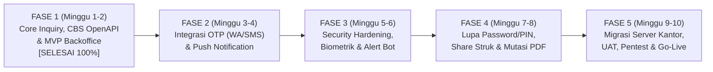

# 📅 TIMELINE & ROADMAP PENGEMBANGAN MOBILE BANKING
## PT BPR DANA MANDIRI BOGOR (`Mobile BPR`)

---

## 1. Ringkasan Eksekutif (Executive Summary)
Pengembangan sistem **Mobile Banking BPR Dana Mandiri Bogor (`Mobile BPR`)** dirancang secara bertahap (*phased delivery*) dengan memprioritaskan **keamanan transaksi**, **akurasi integrasi Core Banking System (CBS)**, serta **kemudahan operasional Backoffice**.

Saat ini **Fase 1 (Fondasi Arsitektur, Integrasi CBS OpenAPI, Fitur Inquiry & MVP Transaksi Internal)** telah **100% selesai** dan berjalan di lingkungan *Staging Server*. Tahapan selanjutnya berfokus pada **Integrasi OTP & Notifikasi Real-time**, **Security Hardening & Early Warning Monitoring**, **Penyempurnaan Fitur Lanjutan**, serta **Migrasi ke Server Production Kantor BPR**.

---

## 2. Peta Jalan (Roadmap) & Estimasi Timeline (Total: 10 – 12 Minggu)

---

## 3. Rincian Pekerjaan Per Fase

### ✅ FASE 1: Foundation, Core Inquiry & MVP Integrasi CBS (Minggu 1 – Minggu 2) — **[STATUS: SELESAI 100%]**
Fokus utama adalah memastikan aplikasi mobile dan middleware dapat berkomunikasi secara *real-time* dan aman dengan **CBS OpenAPI BPR DMB**.

| No | Modul / Fitur | Rincian Deliverable | Status |
| :--- | :--- | :--- | :---: |
| 1.1 | **Integrasi CBS OpenAPI (7 Endpoint)** | Integrasi penuh `GET /ping`, `POST /api/oauth/access-token`, `POST /api/oauth/refresh-token`, `POST /api/nasabah`, `POST /api/savings-accounts`, `POST /api/savings-account-balance`, dan `POST /api/overbooking` lengkap dengan enkripsi `HMAC-SHA512` (`X-Signature`). | ✅ Selesai |
| 1.2 | **Fitur Inquiry Real-Time (MVP Utama)** | Sinkronisasi otomatis data profil lengkap nasabah (12 field CBS), daftar portofolio rekening tabungan, saldo efektif/terblokir/minimum, dan riwayat mutasi saat Login maupun *Pull-to-Refresh* di Beranda. | ✅ Selesai |
| 1.3 | **Aktivasi Akun & Single Device Binding** | Verifikasi CIF & Nomor Rekening ke CBS, pencocokan/registrasi No. HP, pembuatan Password & PIN 6-digit (`bcrypt`), serta penguncian 1 Akun = 1 Perangkat HP (`X-Device-ID`). | ✅ Selesai |
| 1.4 | **Inquiry Rekening Tujuan & Overbooking** | Pengecekan nama penerima otomatis via CBS sebelum transfer dan eksekusi pemindahbukuan antar rekening BPR DMB. | ✅ Selesai |
| 1.5 | **Web Admin Backoffice Portal** | Dashboard monitoring, manajemen nasabah (*Unbind Device* & *Blokir Akun*), CMS Banner Promosi dinamis, Audit Transaksi, manajemen Logo/Parameter Bank, dan RBAC Admin. | ✅ Selesai |
| 1.6 | **Deployment Server Staging (Docker)** | Isolasi layanan dengan Docker Compose (`Go Middleware`, `PostgreSQL 16`, `Redis 7`). | ✅ Selesai |

---

### 💬 FASE 2: Integrasi OTP Real-Time & Sistem Notifikasi (Minggu 3 – Minggu 4)
Mengganti simulasi OTP menjadi pengiriman OTP nyata ke nomor HP nasabah serta mengaktifkan notifikasi transaksi secara *real-time*.

| No | Modul / Fitur | Rincian Deliverable | Estimasi |
| :--- | :--- | :--- | :---: |
| 2.1 | **Integrasi OTP WhatsApp / SMS Gateway** | Integrasi API penyedia WhatsApp Resmi (WABA / Fonnte / Qontak) atau SMS Masking BPR untuk pengiriman kode OTP 6-digit saat Aktivasi Akun, Ganti Perangkat, dan Reset Password/PIN. | Minggu 3 |
| 2.2 | **Manajemen Sesi & Keamanan OTP (Redis)** | Pengaturan masa berlaku OTP (TTL 120 detik), batas salah input OTP maksimal 3 kali, serta *cooldown* pengiriman ulang (*Resend OTP*) 60 detik. | Minggu 3 |
| 2.3 | **Push Notification (Firebase FCM)** | Integrasi Firebase Cloud Messaging (FCM) agar HP nasabah menerima *pop-up* notifikasi instan saat ada dana masuk/keluar, perubahan status akun, atau informasi promo dari BPR. | Minggu 4 |
| 2.4 | **Halaman Inbox Notifikasi & Pusat Bukti Transaksi** | Mengaktifkan menu **Notifikasi** dan **Bukti Transaksi** di pojok kanan atas Beranda agar nasabah dapat melihat kembali seluruh riwayat notifikasi dan struk transfer kapan saja. | Minggu 4 |

---

### 🛡️ FASE 3: Security Hardening, Biometrik & Monitoring Serangan (Minggu 5 – Minggu 6)
Memperkuat pertahanan aplikasi mobile dan server sesuai standar keamanan perbankan (OJK) serta memasang sistem peringatan dini (*Early Warning System*).

| No | Modul / Fitur | Rincian Deliverable | Estimasi |
| :--- | :--- | :--- | :---: |
| 3.1 | **Mobile Security Hardening** | - **Root / Jailbreak & Emulator Detection**: Menolak aplikasi dibuka pada HP yang di-*root* (Magisk) atau menggunakan *hooking* (Frida). - **Screen Capture Protection (`FLAG_SECURE`)**: Mencegah *screenshot* / perekaman layar pada halaman sensitif. - **Code Obfuscation**: Mengacak *source code* APK agar tahan terhadap *reverse engineering*. | Minggu 5 |
| 3.2 | **Biometric Login & Auto-Logout (Idle Timeout)** | - Login cepat menggunakan **Sidik Jari (Fingerprint) / Face ID**. - **Session Idle Timeout**: Otomatis mengunci aplikasi / logout jika didiamkan lebih dari 3 menit. | Minggu 5 |
| 3.3 | **Anti-Double Transfer (Idempotency Lock)** | Penguncian transaksi di Redis untuk mencegah saldo terdebet dua kali apabila nasabah menekan tombol kirim berulang kali saat sinyal lambat. | Minggu 6 |
| 3.4 | **Real-Time Security Alert Bot (Telegram / Email IT)** | Notifikasi peringatan instan ke grup Telegram / Email Tim IT BPR jika terdeteksi: - Percobaan *Brute-Force* Login / PIN 3x berturut-turut - Percobaan masuk dari perangkat tidak dikenal (*Device Mismatch*) - Serangan spam API (*Rate Limit Exceeded*) - Gangguan koneksi ke server CBS (`cbs-openapi`) | Minggu 6 |
| 3.5 | **Proteksi Server (CrowdSec / Fail2Ban & Uptime Monitor)** | Pemasangan IPS (*Intrusion Prevention System*) untuk mem-blokir otomatis IP *hacker* yang melakukan *port scanning* / *SQL injection*, serta dashboard **Uptime Kuma** untuk memantau kesehatan server 24/7. | Minggu 6 |

---

### 🚀 FASE 4: Kelengkapan Fitur Mandiri Nasabah & Pelaporan (Minggu 7 – Minggu 8)
Melengkapi pengalaman pengguna (*User Experience*) agar nasabah dapat mengelola akunnya secara mandiri dan mengunduh bukti/laporan transaksi.

| No | Modul / Fitur | Rincian Deliverable | Estimasi |
| :--- | :--- | :--- | :---: |
| 4.1 | **Alur Lupa Password & Ubah PIN Mandiri** | Fitur *Forgot Password* dan *Ubah PIN Transaksi* langsung dari aplikasi dengan verifikasi OTP + validasi data nasabah. | Minggu 7 |
| 4.2 | **Share Bukti Transaksi (JPG/PDF) & e-Statement** | Fitur membagikan struk bukti transfer langsung ke WhatsApp serta unduh riwayat mutasi rekening dalam format PDF. | Minggu 7 |
| 4.3 | **Daftar Rekening Favorit (Saved Beneficiaries)** | Menyimpan nomor rekening tujuan yang sering ditransfer agar nasabah tidak perlu mengetik ulang nomor rekening. | Minggu 8 |
| 4.4 | **Inquiry Produk Tambahan (Deposito / Pinjaman)*** | Menampilkan informasi portofolio Deposito dan Pinjaman/Kredit nasabah di menu Beranda *(menyesuaikan ketersediaan endpoint dari tim Core Banking)*. | Minggu 8 |

---

### 🖥️ FASE 5: Setup Server Production Kantor BPR, UAT & Go-Live (Minggu 9 – Minggu 10)
Pemindahan sistem dari server *Staging* ke **Server Resmi Kantor BPR DMB**, pengamanan jaringan produksi, pengujian akhir (*User Acceptance Test*), dan rilis aplikasi.

| No | Modul / Fitur | Rincian Deliverable | Estimasi |
| :--- | :--- | :--- | :---: |
| 5.1 | **Provisioning Server Production Kantor BPR** | Setup Ubuntu Server Production di lingkungan kantor/cloud resmi BPR, instalasi Docker Engine, serta konfigurasi *Automated Daily Database Backup* (PostgreSQL). | Minggu 9 |
| 5.2 | **Konfigurasi Domain Resmi, HTTPS (TLS 1.3) & WAF** | - Pemasangan subdomain resmi (misal `mbanking.bprdmb.id`) dengan sertifikat SSL/TLS 1.3. - Konfigurasi **Nginx Reverse Proxy** & **Cloudflare WAF (Web Application Firewall)**. - Pembatasan akses **Web Admin Backoffice (`/admin`)** khusus jaringan internal kantor / VPN. | Minggu 9 |
| 5.3 | **SSL Certificate Pinning (Mobile App)** | Mengunci aplikasi Flutter agar hanya mau berkomunikasi dengan sertifikat SSL resmi milik server BPR DMB (mencegah penyadapan trafik / MITM). | Minggu 9 |
| 5.4 | **UAT (User Acceptance Testing) & Stress Test** | Pengujian skenario transaksi menyeluruh bersama tim operasional BPR DMB serta uji beban (*load testing*). | Minggu 10 |
| 5.5 | **Go-Live & Serah Terima Dokumentasi** | Publikasi aplikasi (`Mobile BPR`) ke Google Play Store / distribusi resmi nasabah, pelatihan Admin Backoffice, dan serah terima dokumen teknis. | Minggu 10 |

---

## 4. ⚠️ Evaluasi & Kekurangan API Core Banking (`CBS OpenAPI`) Saat Ini
Berdasarkan hasil integrasi penuh terhadap **7 Endpoint CBS OpenAPI (`https://cbs-openapi-dev.bprdmb.id/swagger/`)** pada Fase 1, ditemukan beberapa **keterbatasan / kekurangan API dari sisi Core Banking** yang perlu dilengkapi oleh Tim Core Banking BPR DMB agar fitur Mobile Banking dapat berjalan 100% utuh:

| No | Kekurangan pada API CBS Saat Ini | Dampak pada Aplikasi Mobile Banking | Endpoint / Perbaikan yang Dibutuhkan dari Tim CBS | Prioritas |
| :-: | :--- | :--- | :--- | :---: |
| **1** | **Belum Ada Endpoint Riwayat Mutasi Rekening (*Account Statement*)** | Saat ini aplikasi hanya bisa menampilkan mutasi transaksi yang dilakukan lewat aplikasi M-Banking saja. Transaksi yang terjadi di luar M-Banking (Setor Tunai di Teller, Tarik Tunai, Bunga Tabungan, Pajak, Biaya Admin CBS) belum bisa ditarik dari Core Banking. | Menyediakan endpoint baru: **`POST /api/savings-account-mutations`** (input: `no_rekening`, `start_date`, `end_date`) untuk menarik histori mutasi langsung dari tabel buku besar/mutasi CBS. | 🔴 **Tinggi (Wajib)** |
| **2** | **Mayoritas Data `nohp` Nasabah di CBS Bernilai `"0"` (Kosong)** | Dari hasil pengujian endpoint `POST /api/nasabah`, hampir seluruh data nasabah di CBS memiliki `"nohp": "0"` (hanya sebagian kecil seperti CIF `001000336406` yang memiliki No. HP valid). Hal ini berisiko saat fitur **OTP WhatsApp/SMS** diaktifkan karena sistem tidak punya nomor HP acuan resmi dari CBS. | 1. Merapikan/mengisi data `nohp` nasabah aktif di database CBS, **atau** 2. Menyediakan mekanisme/endpoint **`POST /api/nasabah/update-nohp`** yang divalidasi oleh CS/Admin BPR saat nasabah mengaktifkan M-Banking. | 🔴 **Tinggi (Wajib untuk OTP)** |
| **3** | **Endpoint `POST /api/savings-account-balance` Tidak Mengembalikan Nomor `CIF` & `Status Rekening`** | Saat ini response `/api/savings-account-balance` hanya mengembalikan `nama`, `kode_produk`, dan `saldo`, tanpa mengembalikan `cif` pemilik rekening maupun status rekening (`AKTIF` / `DORMANT` / `BLOKIR`). Akibatnya nasabah wajib mengetahui nomor CIF saat registrasi. | Menambahkan field **`cif`** dan **`status_rekening`** pada response JSON `POST /api/savings-account-balance` agar nasabah cukup memasukkan Nomor Rekening saja saat Aktivasi. | 🟠 **Menengah** |
| **4** | **Belum Ada Endpoint Cek Status Transaksi (*Transaction Status Inquiry*) & *Reversal*** | Jika terjadi putus koneksi (*timeout*) di tengah proses `POST /api/overbooking`, Middleware tidak bisa mengecek apakah dana di CBS sebenarnya sudah terpotong atau belum (*suspect transaction*). | Menyediakan endpoint **`POST /api/overbooking/status`** (berdasarkan `X-Reference-No` / `ref_id`) untuk keperluan rekonsiliasi otomatis dan pencegahan selisih saldo. | 🔴 **Tinggi (Standar Audit)** |
| **5** | **Belum Ada Endpoint Inquiry Deposito & Pinjaman/Kredit** | Menu **Deposito** dan **Pinjaman** di aplikasi mobile belum memiliki sumber data dari Core Banking untuk menampilkan daftar bilyet deposito, jatuh tempo, sisa pokok pinjaman, dan jadwal angsuran nasabah. | Menyediakan endpoint inquiry: • **`POST /api/deposito-accounts`** (by `cif`) • **`POST /api/loan-accounts`** (by `cif`) beserta detail angsuran. | 🟡 **Menengah (Fase 4)** |
| **6** | **Response `POST /api/overbooking` Belum Menyertakan Nomor Jurnal Inti CBS & Saldo Akhir** | Saat ini response `/api/overbooking` hanya berisi pesan sukses dan `ref_id` dari header, belum menyertakan nomor jurnal pembukuan internal CBS maupun saldo akhir pengirim setelah transaksi. | Menambahkan field **`core_journal_no`** dan **`saldo_akhir`** pada response `POST /api/overbooking`. | 🟡 **Rendah** |

---

## 5. Kebutuhan dari Pihak Kantor / BPR DMB (Prerequisites per Fase)
Agar timeline di atas berjalan tepat waktu, berikut daftar kebutuhan yang perlu disiapkan oleh pihak BPR DMB pada masing-masing fase:
1. **Dari Tim Core Banking (CBS)**:
   - Penambahan endpoint **Mutasi Rekening (`/api/savings-account-mutations`)**, **Cek Status Overbooking**, perbaikan data **`nohp`**, serta endpoint **Deposito & Pinjaman** sesuai tabel pada Poin 4 di atas.
2. **Fase 2 (OTP & Notifikasi)**:
   - Akun **WhatsApp Business API (WABA)** / vendor OTP gateway pilihan BPR, serta akun **Firebase** resmi BPR.
3. **Fase 5 (Server Kantor & Go-Live)**:
   - Akses **Server Production Kantor BPR** (minimal spesifikasi rekomendasi: 4 vCPU, 8 GB RAM, 100 GB SSD, Ubuntu 24.04 LTS).
   - Akses konfigurasi **Subdomain Resmi** (`*.bprdmb.id`) & koneksi ke **CBS Production**.
   - Akun **Google Play Console** resmi atas nama **PT BPR Dana Mandiri Bogor**.

